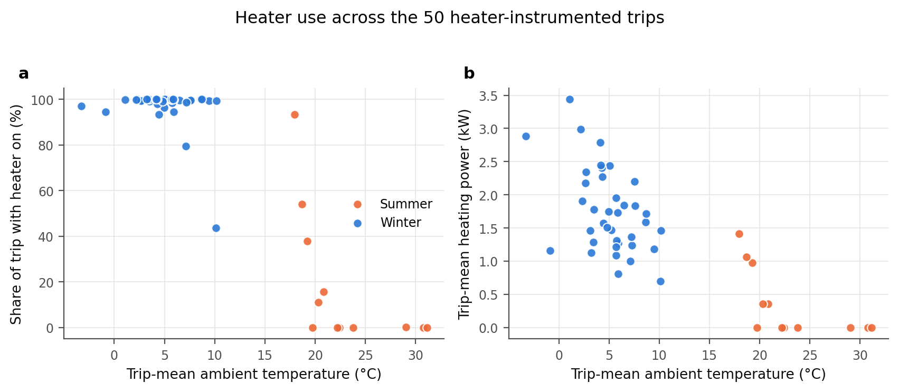
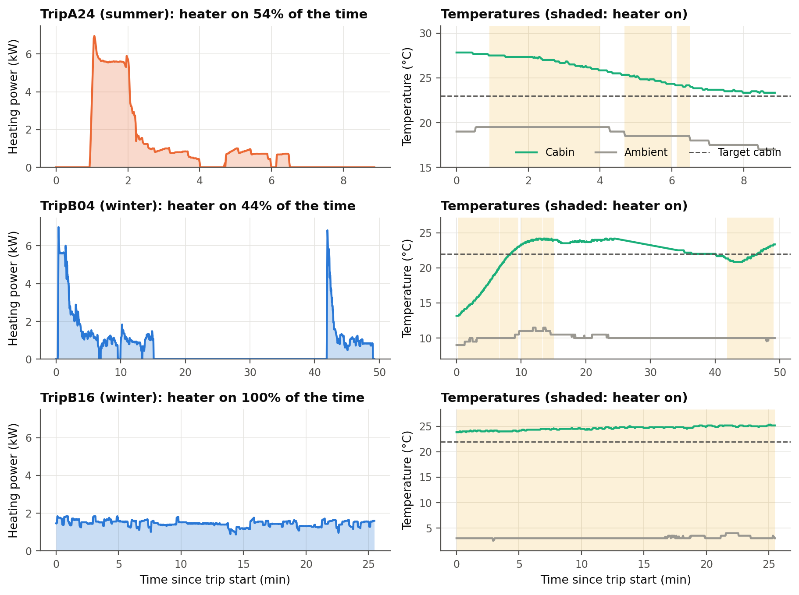
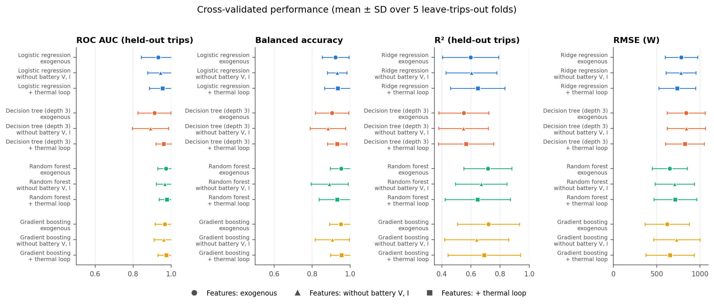
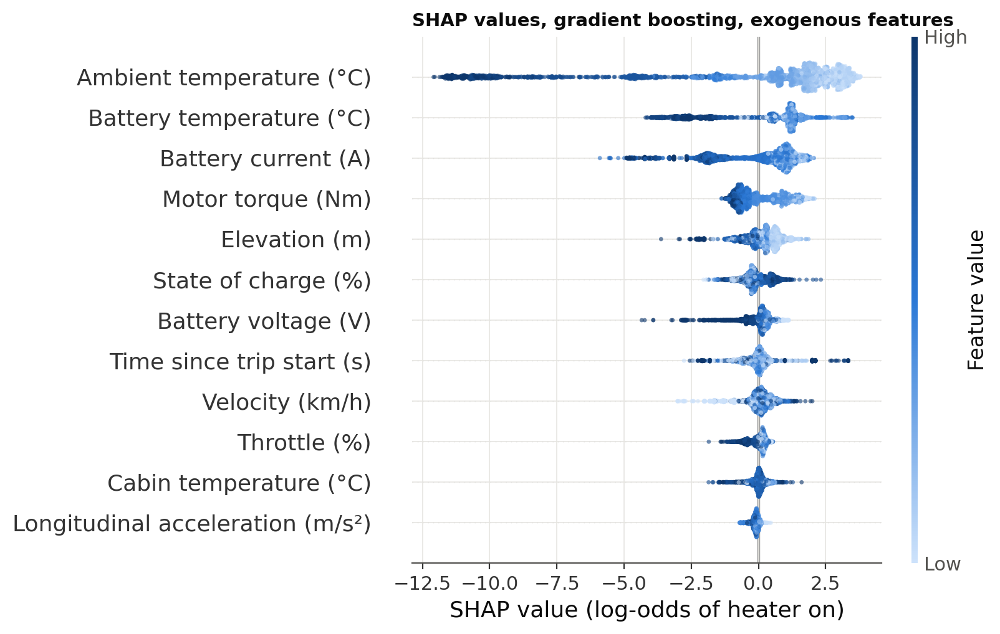
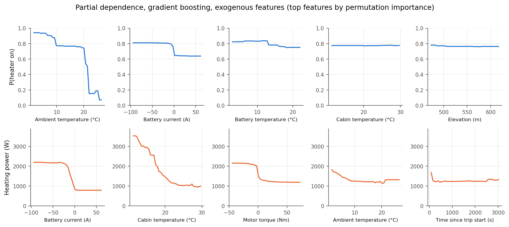
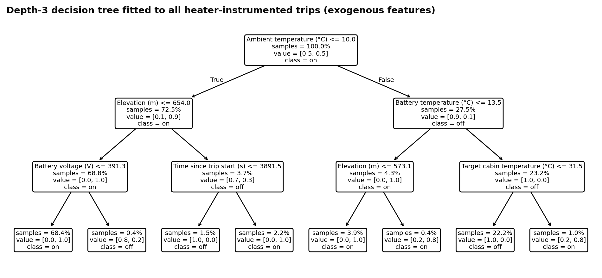

# Battery heating and heater signal

Interpretable machine learning for **when the cabin heater of a battery electric vehicle runs and how much power it draws**, using 70 real-world trips of a BMW i3 recorded by the Technical University of Munich.

The project turns the raw 10 Hz trip logs into a tidy 1 Hz analysis table, trains four model families of increasing flexibility under leave-trips-out cross-validation, and explains the fitted models with permutation importance, SHAP values, partial dependence, standardised coefficients and a depth-3 decision tree. Every number below is traceable to `reports/results.json` and the CSV tables in `reports/tables/`.

## Key findings

- **The raw `Heater Signal` flag is constant within every trip.** It is 1 in 65 trips and 0 in five summer trips (A07, A18, A19, A20, A21). It therefore carries no within-trip information and cannot be predicted at the sample level. The earlier notebooks in `notebooks/archive/` treated it as a per-sample target with a random row split and SMOTE, which measures how well a model recognises a trip rather than how well it understands heating. Those results are superseded.
- **The usable targets are heater current and heating power**, logged in 50 of the 70 trips (12 summer, 38 winter). The heater was on for 11.5 % of summer seconds and 94.4 % of winter seconds, with a mean of 1697 W while on and peaks of up to 8 kW.
- **Heater on/off is predictable on unseen trips** from driving, battery and environment signals alone. Random forest reached a ROC AUC of 0.973 ± 0.043 and balanced accuracy of 0.953 ± 0.058 across five leave-trips-out folds. Ambient temperature dominates: the decision tree's root split is at 10.0 °C, and the partial dependence of P(heater on) drops from about 0.9 below 10 °C to about 0.15 above 22 °C.
- **Heating power is only moderately predictable** (gradient boosting R² 0.720 ± 0.213, RMSE 622 ± 257 W). Cabin temperature, battery current, motor torque and ambient temperature are the main drivers. The large fold-to-fold spread reflects a few trips, notably the summer trips A23 to A25 and the coldest winter trip B38, where the 7 kW warm-up phase is mistimed.
- **Battery current is partly a consequence of the heater** (about 18 A at 7 kW). Dropping battery voltage and current lowers random-forest ROC AUC only from 0.973 to 0.967, but balanced accuracy from 0.953 to 0.891 and heating-power R² from 0.716 to 0.671, so most of the signal is genuinely environmental.
- **Adding the heating-loop temperatures** (heat exchanger and coolant) does not improve the best models beyond their fold-to-fold uncertainty, because those temperatures lag the heater and are themselves a consequence of it.

The full write-up with methods, limitations and figure captions is in [`docs/report.md`](docs/report.md).

## Figures

| | |
|---|---|
|  |  |
| Trip-level heater use against ambient temperature | Three example trips: heating power and cabin, ambient and target temperatures |
|  |  |
| Cross-validated performance of all models and feature sets | SHAP values for heater on/off (gradient boosting) |
|  |  |
| Partial dependence of the two targets on their top features | Depth-3 decision tree for heater on/off |

All 15 figures are in `reports/figures/` as PNG and PDF.

## Cross-validated performance

Mean ± SD over five leave-trips-out folds, exogenous features (driving state, battery state, ambient and cabin temperature, target cabin temperature). The complete table including the two alternative feature sets is in `reports/tables/cv_summary.md`.

| Model | Heater on/off: ROC AUC | Balanced accuracy | Heating power: R² | RMSE (W) |
|---|---|---|---|---|
| Logistic / ridge regression | 0.933 ± 0.090 | 0.923 ± 0.071 | 0.597 ± 0.192 | 785 ± 188 |
| Decision tree (depth 3) | 0.912 ± 0.087 | 0.904 ± 0.088 | 0.551 ± 0.172 | 840 ± 218 |
| Random forest | 0.973 ± 0.043 | 0.953 ± 0.058 | 0.716 ± 0.165 | 650 ± 204 |
| Gradient boosting | 0.968 ± 0.052 | 0.951 ± 0.061 | 0.720 ± 0.213 | 622 ± 257 |

## Data

- Source: *Battery and Heating Data in Real Driving Cycles*, Institute of Automotive Technology, Technical University of Munich. IEEE DataPort, DOI [10.21227/6jr9-5235](https://doi.org/10.21227/6jr9-5235). A mirror is on [Kaggle](https://www.kaggle.com/datasets/atechnohazard/battery-and-heating-data-in-real-driving-cycles).
- 32 summer trips (June to September 2019, `TripA*.csv`) and 38 winter trips (December 2019 to January 2020, `TripB*.csv`) at 10 Hz, plus `Overview.csv` with per-trip metadata. Summer trips were recorded with a reduced sensor set; only 12 of them logged heater current.
- The raw CSV files are not stored in this repository. Download them from the DOI above and place them in `data/raw/`.

## Repository layout

```
.
├── data/
│   ├── raw/            # TripA*.csv, TripB*.csv, Overview.csv (not versioned)
│   └── processed/      # 1 Hz analysis table and fitted models (not versioned)
├── docs/report.md      # methods, results, limitations, figure captions
├── notebooks/archive/  # original exploratory notebooks (superseded)
├── reports/
│   ├── figures/        # fig01 .. fig14 (PNG + PDF)
│   ├── tables/         # CSV and Markdown tables
│   └── results.json    # registry of every quoted number
├── src/battery_heating/
│   ├── config.py       # paths, column names, feature sets, settings
│   ├── data.py         # loading, cleaning, 1 Hz resampling
│   ├── features.py     # derived features, feature matrices, trip summaries
│   ├── models.py       # model factories with fixed hyper-parameters
│   ├── evaluation.py   # leave-trips-out CV and metrics
│   ├── interpret.py    # permutation importance, SHAP, PDP, coefficients
│   ├── plotting.py     # all figures
│   └── pipeline.py     # prepare / describe / train / interpret / report
├── tests/              # pytest unit tests
├── PROJECT_SOURCES.md  # source map: which file is authoritative for what
└── pyproject.toml
```

## Reproduce

```bash
python -m venv .venv && .venv\Scripts\activate      # Windows
pip install -e ".[dev]"
python -m battery_heating all                        # ~15 min on 8 cores
```

Individual stages: `prepare`, `describe`, `train`, `interpret`, `report`. Quality checks:

```bash
ruff check src tests && ruff format --check src tests
python -m pytest
```

Software used for the reported results: Python 3.11.4, pandas 3.0.6, NumPy 2.0.2, scikit-learn 1.9.1, SHAP 0.51.0, matplotlib 3.9.0. Random seed 42 throughout.

## Methods in brief

1. **Cleaning.** Column headers are normalised (one trip has a mis-typed velocity header, every file has a bracket typo in `max. SoC`, the winter files carry a duplicated vent-temperature column). Heating-power readings above 8 kW (1580 rows in TripB02, physically impossible for the 7 kW heater) are masked.
2. **Resampling.** Each trip is averaged into 1 s bins, giving 78 282 seconds (21.7 h) across 50 trips. `heater_on` = heater current above 0 A for more than half of the bin; `heating_power_w` = LIN-bus heating power.
3. **Features.** Fifteen exogenous signals. Two alternatives are evaluated: without battery voltage and current (which respond to the heater's own draw), and with the four heating-loop temperatures added.
4. **Validation.** `StratifiedGroupKFold` with five folds, whole trips held out, folds balanced by season. Hyper-parameters were fixed a priori rather than tuned.
5. **Interpretation.** Permutation importance on held-out folds, SHAP values (TreeExplainer on a 3000-row sample), one-dimensional partial dependence, standardised linear coefficients with fold-to-fold SD, and a depth-3 tree.

## Licence

Code is released under the MIT licence (see `LICENSE`). The dataset is subject to the terms on IEEE DataPort.
